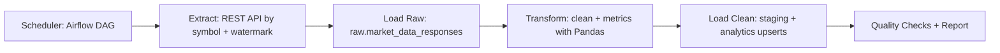

# Architecture

## Notes
- Provider is configurable (default Alpha Vantage).
- Raw and transformed layers are stored separately.
- Pipeline is designed to be idempotent via unique keys and upserts.
